# STREAMPLAY-2-REBUILD initiative plan

All ADR recommendations remain proposed. Milestone 1 starts only after owner acceptance of ADR-001, ADR-002, ADR-003, ADR-004 and ADR-012 through `TECH-ADR-BASE`. The manifest is the machine-readable scheduling source.

## Milestones

| Milestone | Goal and exit criteria | Jobs |
| --- | --- | --- |
| 0 | Audit legacy and decide foundation ADRs; exit with two POCs and owner decisions. | TECH-AUDIT-LEGACY, TECH-POC-GUI, TECH-POC-PLAYER, TECH-ADR-BASE |
| 1 | Establish workspace, domain contracts, design system, persistence and import pipeline; exit with BDD and adapter gates green. | TECH-RUST-WORKSPACE, TECH-DESIGN-SYSTEM, TECH-DOMAIN-SPACE, TECH-DOMAIN-CATALOG, TECH-DOMAIN-PLAYLIST, TECH-DOMAIN-EPG, TECH-DOMAIN-PLAYBACK, TECH-DOMAIN-CATEGORY, TECH-PERSISTENCE, TECH-INTEGRATION-PIPELINE |
| 2 | Complete Space → playlist → live playback → EPG vertical slice; exit with real data paths and recovery behavior. | SP-21, SP-22, SP-24, SP-04, SP-05, SP-06, SP-07 |
| 3 | Complete discovery, VOD, favorites, history and gated downloads; exit with screen scenarios and three-theme review. | SP-02, SP-03, SP-09, SP-10, SP-11, SP-08, SP-13, SP-14, SP-15, SP-12, SP-16, SP-17, SP-01, SP-18 |
| 4 | Complete MultiView, settings and category administration; exit with provider capability and conflict handling. | SP-19-20, SP-23, SP-25, SP-26, SP-27, SP-28, SP-29, SP-30, SP-31-32, SP-33 |
| 5 | Migrate, harden, review every screen and package; exit with migration, performance, security and release gates. | TECH-MIGRATION, TECH-PERF, TECH-SECURITY, TECH-UX-REVIEW, TECH-RELEASE |

## Dependency DAG

Each node and edge below corresponds exactly to one entry or `dependsOn` relationship in `docs/backlog/jobs.yaml`.

```mermaid
flowchart TD
  TECH-AUDIT-LEGACY["TECH-AUDIT-LEGACY"]
  TECH-POC-GUI["TECH-POC-GUI"]
  TECH-POC-PLAYER["TECH-POC-PLAYER"]
  TECH-ADR-BASE["TECH-ADR-BASE"]
  TECH-RUST-WORKSPACE["TECH-RUST-WORKSPACE"]
  TECH-DESIGN-SYSTEM["TECH-DESIGN-SYSTEM"]
  TECH-DOMAIN-SPACE["TECH-DOMAIN-SPACE"]
  TECH-DOMAIN-CATALOG["TECH-DOMAIN-CATALOG"]
  TECH-DOMAIN-PLAYLIST["TECH-DOMAIN-PLAYLIST"]
  TECH-DOMAIN-EPG["TECH-DOMAIN-EPG"]
  TECH-DOMAIN-PLAYBACK["TECH-DOMAIN-PLAYBACK"]
  TECH-DOMAIN-CATEGORY["TECH-DOMAIN-CATEGORY"]
  TECH-PERSISTENCE["TECH-PERSISTENCE"]
  TECH-INTEGRATION-PIPELINE["TECH-INTEGRATION-PIPELINE"]
  SP-21["SP-21"]
  SP-22["SP-22"]
  SP-24["SP-24"]
  SP-04["SP-04"]
  SP-05["SP-05"]
  SP-06["SP-06"]
  SP-07["SP-07"]
  SP-02["SP-02"]
  SP-03["SP-03"]
  SP-09["SP-09"]
  SP-10["SP-10"]
  SP-11["SP-11"]
  SP-08["SP-08"]
  SP-13["SP-13"]
  SP-14["SP-14"]
  SP-15["SP-15"]
  SP-12["SP-12"]
  SP-16["SP-16"]
  SP-17["SP-17"]
  SP-01["SP-01"]
  SP-18["SP-18"]
  SP-19-20["SP-19-20"]
  SP-23["SP-23"]
  SP-25["SP-25"]
  SP-26["SP-26"]
  SP-27["SP-27"]
  SP-28["SP-28"]
  SP-29["SP-29"]
  SP-30["SP-30"]
  SP-31-32["SP-31-32"]
  SP-33["SP-33"]
  TECH-MIGRATION["TECH-MIGRATION"]
  TECH-PERF["TECH-PERF"]
  TECH-SECURITY["TECH-SECURITY"]
  TECH-UX-REVIEW["TECH-UX-REVIEW"]
  TECH-RELEASE["TECH-RELEASE"]
  TECH-AUDIT-LEGACY --> TECH-POC-GUI
  TECH-AUDIT-LEGACY --> TECH-POC-PLAYER
  TECH-AUDIT-LEGACY --> TECH-ADR-BASE
  TECH-POC-GUI --> TECH-ADR-BASE
  TECH-POC-PLAYER --> TECH-ADR-BASE
  TECH-POC-GUI --> TECH-RUST-WORKSPACE
  TECH-POC-PLAYER --> TECH-RUST-WORKSPACE
  TECH-ADR-BASE --> TECH-RUST-WORKSPACE
  TECH-POC-GUI --> TECH-DESIGN-SYSTEM
  TECH-POC-PLAYER --> TECH-DESIGN-SYSTEM
  TECH-ADR-BASE --> TECH-DESIGN-SYSTEM
  TECH-RUST-WORKSPACE --> TECH-DESIGN-SYSTEM
  TECH-POC-GUI --> TECH-DOMAIN-SPACE
  TECH-POC-PLAYER --> TECH-DOMAIN-SPACE
  TECH-ADR-BASE --> TECH-DOMAIN-SPACE
  TECH-RUST-WORKSPACE --> TECH-DOMAIN-SPACE
  TECH-POC-GUI --> TECH-DOMAIN-CATALOG
  TECH-POC-PLAYER --> TECH-DOMAIN-CATALOG
  TECH-ADR-BASE --> TECH-DOMAIN-CATALOG
  TECH-RUST-WORKSPACE --> TECH-DOMAIN-CATALOG
  TECH-POC-GUI --> TECH-DOMAIN-PLAYLIST
  TECH-POC-PLAYER --> TECH-DOMAIN-PLAYLIST
  TECH-ADR-BASE --> TECH-DOMAIN-PLAYLIST
  TECH-RUST-WORKSPACE --> TECH-DOMAIN-PLAYLIST
  TECH-POC-GUI --> TECH-DOMAIN-EPG
  TECH-POC-PLAYER --> TECH-DOMAIN-EPG
  TECH-ADR-BASE --> TECH-DOMAIN-EPG
  TECH-RUST-WORKSPACE --> TECH-DOMAIN-EPG
  TECH-POC-GUI --> TECH-DOMAIN-PLAYBACK
  TECH-POC-PLAYER --> TECH-DOMAIN-PLAYBACK
  TECH-ADR-BASE --> TECH-DOMAIN-PLAYBACK
  TECH-RUST-WORKSPACE --> TECH-DOMAIN-PLAYBACK
  TECH-POC-GUI --> TECH-DOMAIN-CATEGORY
  TECH-POC-PLAYER --> TECH-DOMAIN-CATEGORY
  TECH-ADR-BASE --> TECH-DOMAIN-CATEGORY
  TECH-DOMAIN-CATALOG --> TECH-DOMAIN-CATEGORY
  TECH-POC-GUI --> TECH-PERSISTENCE
  TECH-POC-PLAYER --> TECH-PERSISTENCE
  TECH-ADR-BASE --> TECH-PERSISTENCE
  TECH-DOMAIN-SPACE --> TECH-PERSISTENCE
  TECH-DOMAIN-CATALOG --> TECH-PERSISTENCE
  TECH-DOMAIN-CATEGORY --> TECH-PERSISTENCE
  TECH-DOMAIN-PLAYLIST --> TECH-PERSISTENCE
  TECH-DOMAIN-EPG --> TECH-PERSISTENCE
  TECH-POC-GUI --> TECH-INTEGRATION-PIPELINE
  TECH-POC-PLAYER --> TECH-INTEGRATION-PIPELINE
  TECH-ADR-BASE --> TECH-INTEGRATION-PIPELINE
  TECH-PERSISTENCE --> TECH-INTEGRATION-PIPELINE
  TECH-DOMAIN-PLAYLIST --> TECH-INTEGRATION-PIPELINE
  TECH-DOMAIN-EPG --> TECH-INTEGRATION-PIPELINE
  TECH-DOMAIN-CATEGORY --> TECH-INTEGRATION-PIPELINE
  TECH-DESIGN-SYSTEM --> SP-21
  TECH-DOMAIN-SPACE --> SP-21
  TECH-PERSISTENCE --> SP-21
  SP-21 --> SP-22
  SP-22 --> SP-24
  TECH-INTEGRATION-PIPELINE --> SP-24
  SP-24 --> SP-04
  TECH-INTEGRATION-PIPELINE --> SP-04
  SP-04 --> SP-05
  TECH-DOMAIN-PLAYBACK --> SP-05
  SP-05 --> SP-06
  TECH-DOMAIN-EPG --> SP-06
  SP-06 --> SP-07
  SP-24 --> SP-02
  TECH-DOMAIN-CATALOG --> SP-02
  TECH-DESIGN-SYSTEM --> SP-02
  SP-02 --> SP-03
  TECH-DESIGN-SYSTEM --> SP-03
  SP-08 --> SP-09
  TECH-DESIGN-SYSTEM --> SP-09
  SP-09 --> SP-10
  TECH-DESIGN-SYSTEM --> SP-10
  SP-10 --> SP-11
  TECH-DOMAIN-PLAYBACK --> SP-11
  TECH-DESIGN-SYSTEM --> SP-11
  SP-24 --> SP-08
  TECH-DESIGN-SYSTEM --> SP-08
  SP-12 --> SP-13
  TECH-DESIGN-SYSTEM --> SP-13
  SP-13 --> SP-14
  TECH-DESIGN-SYSTEM --> SP-14
  SP-14 --> SP-15
  TECH-DOMAIN-PLAYBACK --> SP-15
  TECH-DESIGN-SYSTEM --> SP-15
  SP-24 --> SP-12
  TECH-DESIGN-SYSTEM --> SP-12
  SP-24 --> SP-16
  TECH-DESIGN-SYSTEM --> SP-16
  SP-11 --> SP-17
  SP-15 --> SP-17
  TECH-DESIGN-SYSTEM --> SP-17
  SP-02 --> SP-01
  SP-16 --> SP-01
  SP-17 --> SP-01
  TECH-DESIGN-SYSTEM --> SP-01
  SP-24 --> SP-18
  TECH-DESIGN-SYSTEM --> SP-18
  SP-05 --> SP-19-20
  TECH-DOMAIN-PLAYBACK --> SP-19-20
  TECH-DESIGN-SYSTEM --> SP-19-20
  SP-21 --> SP-23
  TECH-DESIGN-SYSTEM --> SP-23
  SP-06 --> SP-25
  TECH-DESIGN-SYSTEM --> SP-25
  TECH-DESIGN-SYSTEM --> SP-26
  SP-11 --> SP-27
  TECH-DESIGN-SYSTEM --> SP-27
  SP-10 --> SP-28
  TECH-DESIGN-SYSTEM --> SP-28
  SP-24 --> SP-29
  TECH-DESIGN-SYSTEM --> SP-29
  SP-24 --> SP-30
  SP-22 --> SP-30
  TECH-DESIGN-SYSTEM --> SP-30
  SP-30 --> SP-31-32
  TECH-DOMAIN-CATEGORY --> SP-31-32
  TECH-DESIGN-SYSTEM --> SP-31-32
  SP-31-32 --> SP-33
  TECH-DESIGN-SYSTEM --> SP-33
  TECH-PERSISTENCE --> TECH-MIGRATION
  TECH-AUDIT-LEGACY --> TECH-MIGRATION
  SP-19-20 --> TECH-PERF
  TECH-INTEGRATION-PIPELINE --> TECH-PERF
  TECH-INTEGRATION-PIPELINE --> TECH-SECURITY
  SP-18 --> TECH-SECURITY
  SP-28 --> TECH-SECURITY
  SP-21 --> TECH-UX-REVIEW
  SP-22 --> TECH-UX-REVIEW
  SP-24 --> TECH-UX-REVIEW
  SP-04 --> TECH-UX-REVIEW
  SP-05 --> TECH-UX-REVIEW
  SP-06 --> TECH-UX-REVIEW
  SP-07 --> TECH-UX-REVIEW
  SP-02 --> TECH-UX-REVIEW
  SP-03 --> TECH-UX-REVIEW
  SP-09 --> TECH-UX-REVIEW
  SP-10 --> TECH-UX-REVIEW
  SP-11 --> TECH-UX-REVIEW
  SP-08 --> TECH-UX-REVIEW
  SP-13 --> TECH-UX-REVIEW
  SP-14 --> TECH-UX-REVIEW
  SP-15 --> TECH-UX-REVIEW
  SP-12 --> TECH-UX-REVIEW
  SP-16 --> TECH-UX-REVIEW
  SP-17 --> TECH-UX-REVIEW
  SP-01 --> TECH-UX-REVIEW
  SP-18 --> TECH-UX-REVIEW
  SP-19-20 --> TECH-UX-REVIEW
  SP-23 --> TECH-UX-REVIEW
  SP-25 --> TECH-UX-REVIEW
  SP-26 --> TECH-UX-REVIEW
  SP-27 --> TECH-UX-REVIEW
  SP-28 --> TECH-UX-REVIEW
  SP-29 --> TECH-UX-REVIEW
  SP-30 --> TECH-UX-REVIEW
  SP-31-32 --> TECH-UX-REVIEW
  SP-33 --> TECH-UX-REVIEW
  TECH-MIGRATION --> TECH-RELEASE
  TECH-PERF --> TECH-RELEASE
  TECH-SECURITY --> TECH-RELEASE
  TECH-UX-REVIEW --> TECH-RELEASE
```

## Critical path

Longest dependency chain by job count (execution duration is not estimated):

`TECH-AUDIT-LEGACY` → `TECH-POC-GUI` → `TECH-ADR-BASE` → `TECH-RUST-WORKSPACE` → `TECH-DOMAIN-CATALOG` → `TECH-DOMAIN-CATEGORY` → `TECH-PERSISTENCE` → `SP-21` → `SP-22` → `SP-24` → `SP-08` → `SP-09` → `SP-10` → `SP-11` → `SP-17` → `SP-01` → `TECH-UX-REVIEW` → `TECH-RELEASE`

This chain has 18 jobs. The catalog/category/persistence pipeline is the main foundation bottleneck; all screens then converge at `TECH-UX-REVIEW`, which gates `TECH-RELEASE`. The precise critical path may change when job durations are estimated.

## Parallel work

| After gate | Jobs that can proceed concurrently | Constraint |
| --- | --- | --- |
| Legacy audit | TECH-POC-GUI and TECH-POC-PLAYER | Both feed TECH-ADR-BASE. |
| Foundation approval | TECH-DESIGN-SYSTEM, TECH-DOMAIN-SPACE, TECH-DOMAIN-CATALOG, TECH-DOMAIN-PLAYLIST, TECH-DOMAIN-EPG, TECH-DOMAIN-PLAYBACK | Stable interfaces must be published before consuming jobs. |
| Integration pipeline | SP-21/SP-22 and independent catalog screens | SP-24 waits for both Space and pipeline paths. |
| Vertical slice | Search, movies, series, favorites and settings branches | Feature-gated ADRs are accepted before their first jobs. |
| Domain and feature gates complete | TECH-MIGRATION, TECH-PERF and TECH-SECURITY | TECH-UX-REVIEW waits for every screen; release waits for all hardening. |

## Serialized contracts

| Concern | Owning job | Ordering rule |
| --- | --- | --- |
| Schema migrations | TECH-PERSISTENCE, then TECH-MIGRATION | One owner assigns versions; migration changes follow persisted domain contracts and use backup/rollback. |
| App-shell API | TECH-DESIGN-SYSTEM | Screen jobs consume the published shell API; changes return through this owner. |
| Player interface | TECH-DOMAIN-PLAYBACK | SP-05 and VOD/MultiView jobs depend on the stable player contract. |
| Theme tokens | TECH-DESIGN-SYSTEM | SP-26 and screen jobs consume the same named tokens across all three themes. |
| Category identity | TECH-DOMAIN-CATEGORY | Pipeline and SP-31-32 use stable IDs; provider refresh cannot replace local identity. |

## Risks

| Risk | Likelihood | Impact | Mitigation | Owner |
| --- | --- | --- | --- | --- |
| UI/player navigation loses session | medium | high | POC persistent player core and navigation E2E | TECH-POC-PLAYER |
| Untrusted IPTV data or wrong EPG match | high | high | Bound parsers, fixtures, confidence score and manual overrides | TECH-INTEGRATION-PIPELINE |
| Distribution rights for streams, metadata, fonts and codecs | high | high | Licence inventory and owner ADR gates | TECH-ADR-BASE |
| Legacy migration loses personal state | medium | high | Read-only source, backup, dry-run and rollback | TECH-MIGRATION |
| Agents treat unknowns as fact | medium | high | Contract tickets, evidence citations and owner ADR approval | TECH-ADR-BASE |
| Screen visual drift across builders | high | medium | Shared tokens and screenshots in all three themes | TECH-DESIGN-SYSTEM |
| Mixed-language UI copy | high | medium | Reviewed localization strings and UX pass | TECH-UX-REVIEW |
| Reusable secrets remain in SQLite | high | high | Vault migration and security review | TECH-SECURITY |
| Decoded artwork growth | medium | medium | Benchmark and bound decoded cache | TECH-PERF |
| Public repository leak of private provider data | medium | critical | Synthetic fixtures and pre-delivery leak scan | TECH-SECURITY |
| Snapshot and handover drift | high | medium | Live audit and open question OQ-002 | TECH-AUDIT-LEGACY |

## Changes from source backlog

| Job(s) | Change | Reason |
| --- | --- | --- |
| SP-19-20 | Merge SP-19 and SP-20 | Shared MultiView session and layout contract can be reviewed together. |
| SP-31-32 | Merge SP-31 and SP-32 | Category list and editor share identity and draft flow. |
| All other TECH-* and SP-* jobs | Retained | Source backlog scope remains independently reviewable. The source names 19 TECH jobs; the planner’s 20-job estimate was a counting error. |
