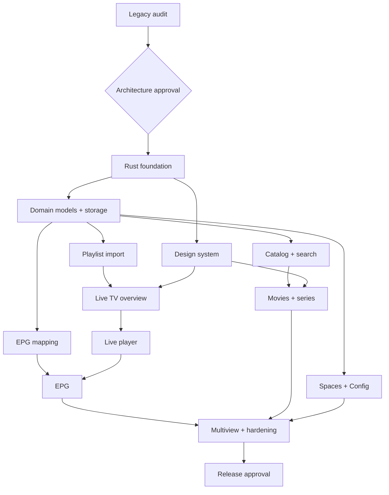

# StreamPlay 2.0 — Initiative-, milestone- en jobplanning

## Algemeen
**Root initiative:** `STREAMPLAY-2-REBUILD`. Elke job is klein genoeg om zelfstandig reviewbaar te zijn en heeft inputdocumenten, Gherkin-scenario's, afhankelijkheden, outputartefacten en testgates. Implementatievolgorde volgt domeinafhankelijkheden, niet uitsluitend UI-schermvolgorde.

## Milestone 0 — Verkenning en beslissingen
- `TECH-AUDIT-LEGACY`: map bestaande Rust functies, modulegraph, providers, persistentie en player; schrijf capability matrix.
- `TECH-POC-GUI`: benchmark native macOS titlebar, video embedding, a11y, DPI/scaling en screenshots van twee kandidaat-stacks.
- `TECH-POC-PLAYER`: proef HLS/TS, subtitle tracks, hardware decoding en blijvende sessies.
- `TECH-ADR-BASE`: laat owner akkoord geven op GUI, player, db, providerformats, licenties.

## Milestone 1 — Foundation
- `TECH-RUST-WORKSPACE`: nieuw project, CI, formatting, lint, audit, fixtures, cargo workspace.
- `TECH-DESIGN-SYSTEM`: drie thema's, Asap Sharp setup, ProIcons registry, primitives, app-shell en native window chrome.
- `TECH-DOMAIN-SPACE`, `TECH-DOMAIN-CATALOG`, `TECH-DOMAIN-CATEGORY`, `TECH-DOMAIN-PLAYLIST`, `TECH-DOMAIN-EPG`, `TECH-DOMAIN-PLAYBACK`: contracts/invarianten en BDD fixtures.
- `TECH-PERSISTENCE`: databasemigraties + transactions + backup/rollback.
- `TECH-INTEGRATION-PIPELINE`: importer/sync/indexer met data provenance.

## Milestone 2 — Eerste complete vertical slice
- `SP-21` Spaces-overzicht en `SP-22` Space-editor → `SP-24` Playlists → `SP-04` kanaaloverzicht → `SP-05` liveplayer → `SP-06` EPG → `SP-07` embedded EPG. Integreer data source, player en persistentie zonder hardcoded demo data.

## Milestone 3 — Discover en VOD
- `SP-01..03` Home, search en results (vereist catalog/search).
- `SP-08..11` film ontdekkings-, catalogus-, detail- en playerflow.
- `SP-12..15` series ontdekken, catalogus, detail, episodeplayer.
- `SP-16..18` favorieten, verder kijken, downloads (downloads feature-gated door ADR).

## Milestone 4 — Power use & admin
- `SP-19..20` MultiView en presets (na player capacity spike).
- `SP-30..33` Config dashboard, categoriebeheer, editor, rules en mappings.
- `SP-23,25..29` profiel, EPG settings, appearance, subtitle/audio, metadata, library.

## Milestone 5 — Hardening & delivery
- `TECH-MIGRATION`: legacy user data migratie na schema- en auditbesluit.
- `TECH-PERF`: load tests op 30k+ kanalen, 80k+ films, grote XMLTV en MultiView.
- `TECH-SECURITY`: fuzz playlist/EPG parser, secret handling, downloads, storage.
- `TECH-UX-REVIEW`: all 33 screens × 3 themes, accessibility, RTL, scaling, keyboard.
- `TECH-RELEASE`: macOS signing/notarization, backup/rollback, CI installer.

## Dependency voorbeeld

## Voorbeeld job-acceptatie
Job `SP-32`: Asap Sharp typography/tokens toegepast, editor heeft titel/omschrijving/twee artworkslots, uploadvalidatie, preview, saved vs draft guard, per-Space visibility, 4 hoofdscenario's geautomatiseerd plus media file validation; screenshots voor dark/navy/light; security/a11y reviews groen.

## Reviewmatrix
| Werk | Verplichte onafhankelijke review |
|---|---|
| Rust domain & persistence | Rust architect + BDD engineer |
| Player/EPG/providers | Rust/performance + security + BDD |
| UI | UI/UX + accessibility + screenshot |
| Assets/upload/download | Security/privacy + licensing |
| Release/migration | Migration owner + CI + human approval |

## Notities
Factory job IDs en formats in dit document zijn voorstellen; koppel deze aan het daadwerkelijke model in jouw Software Factory. Parallelle jobs alleen wanneer interfaces en migraties niet conflicteren. Bewaar agentlogs/reviews buiten app-repository conform jouw beleid.
